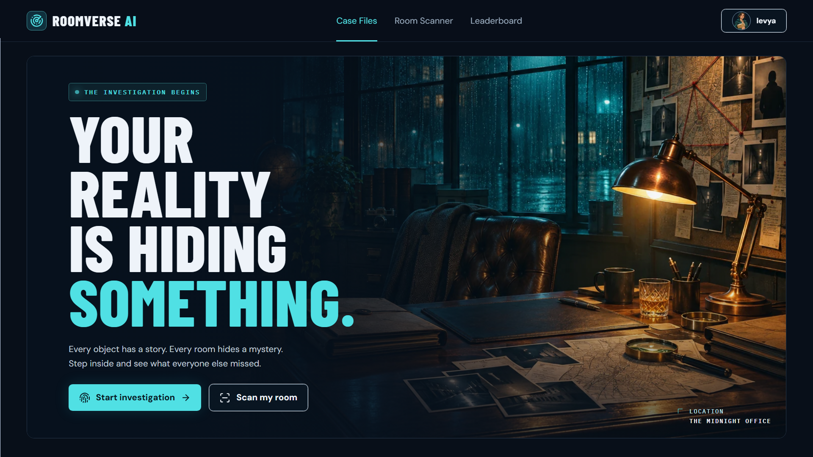
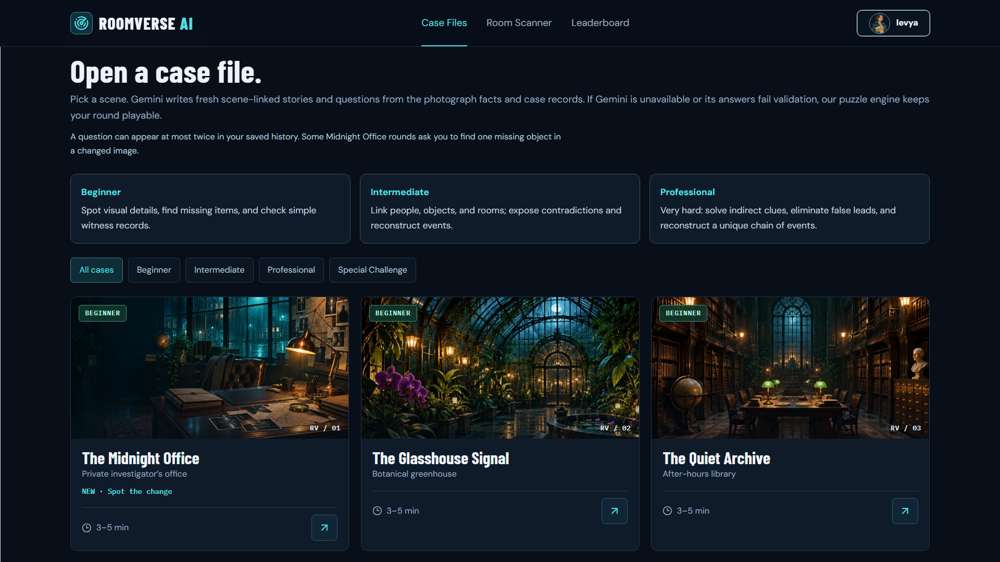
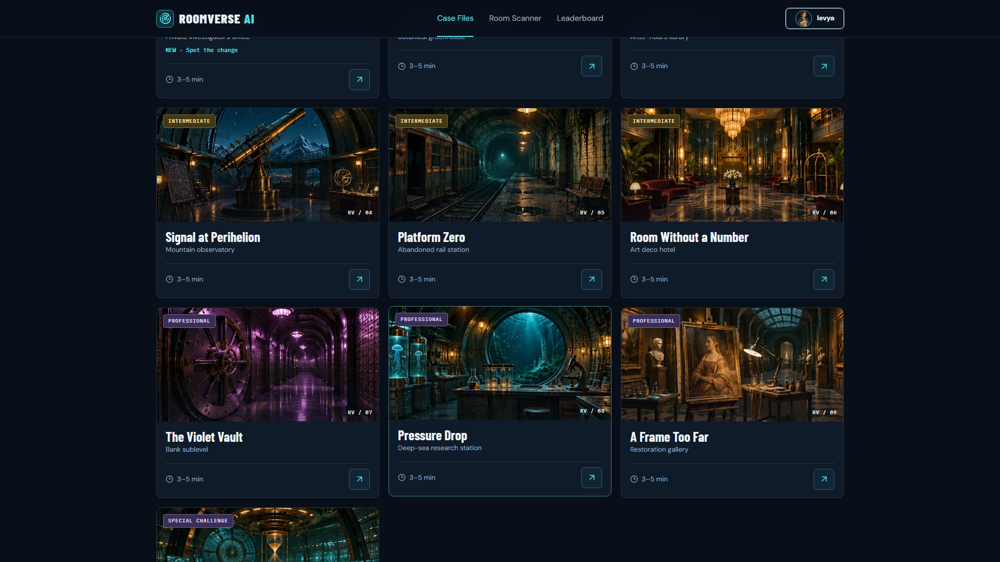
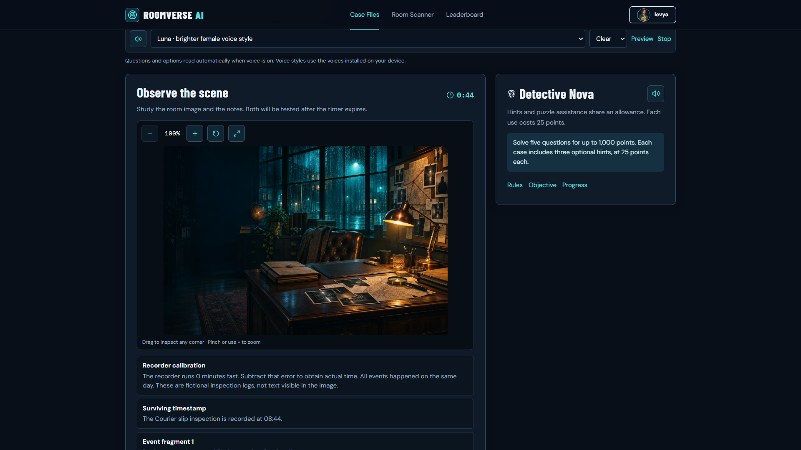
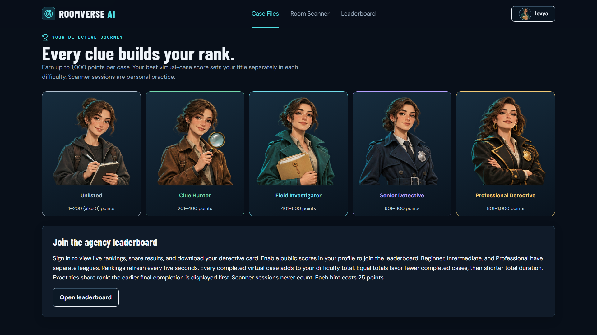
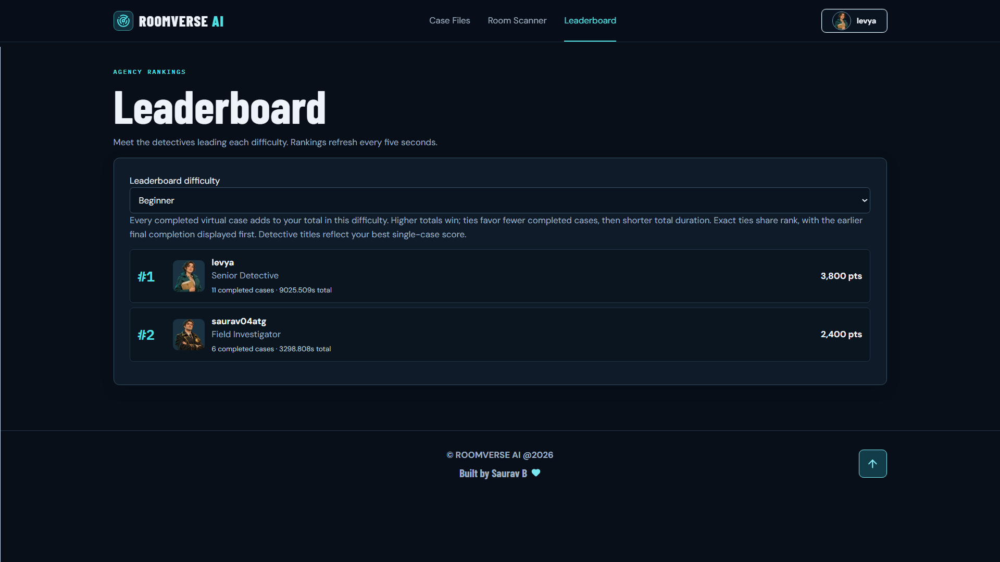
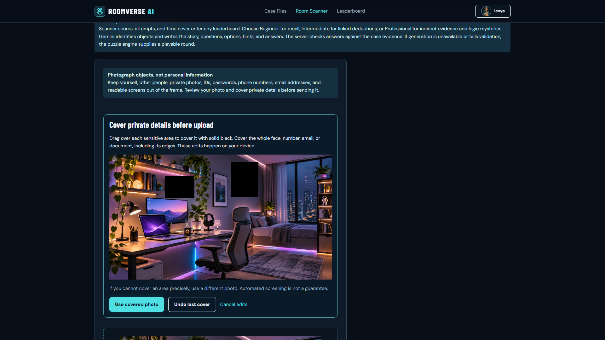
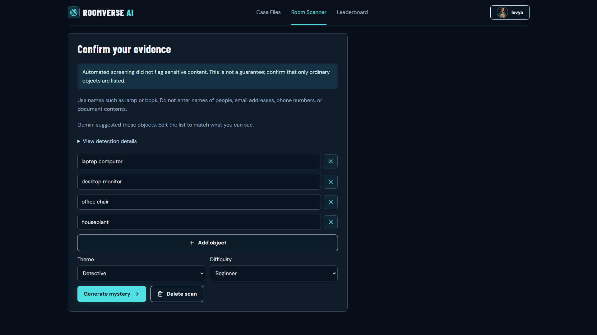
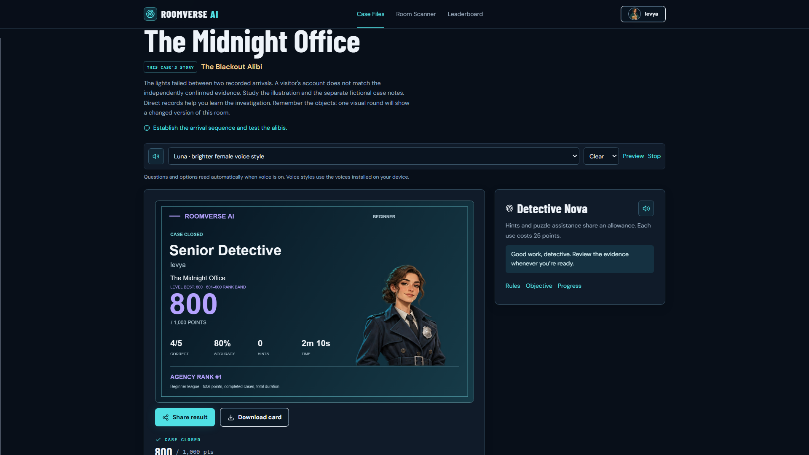

# ROOMVERSE AI

### Observe. Remember. Investigate.

An AI-powered detective game that combines room exploration, visual memory, and logical reasoning. Study illustrated scenes or scan your surroundings, examine the evidence, and solve the mystery.

**Built by Saurav B** · **Powered by Google Gemini**



---

## About the Project

ROOMVERSE AI turns observation practice into interactive investigations. Players study a scene, remember important details, and answer five questions based on images and fictional case records.

Gemini creates stories and questions from verified evidence. The backend checks the answers, and a local puzzle engine supplies a playable round if Gemini is unavailable or its response fails validation.

## Features

| Feature | What it does |
| --- | --- |
| **Virtual investigations** | Explore ten illustrated scenes across Beginner, Intermediate, Professional, and Special Challenge categories. |
| **Different case formats** | Solve packet audits, event timelines, access-route puzzles, and witness investigations. |
| **Gemini-generated rounds** | Get stories, questions, options, hints, answers, and explanations based on case evidence. |
| **Room scanner** | Use a laptop webcam, mobile camera, or uploaded photo for personal practice. |
| **Question archive** | Preserve stories and answers, and check new virtual rounds against previously generated content. |
| **Voice reading** | Listen to questions, options, and hints with selectable voice presets and speeds. |
| **Image exploration** | Zoom, pan, and expand images, with clear Close and Escape controls. |
| **Player profiles** | Save progress, select detective avatars, and keep voice preferences across devices. |
| **Leaderboards** | Compare cumulative scores within separate difficulty categories. |
| **Result cards** | Share and download detective cards when signed in. |

## Benefits

ROOMVERSE AI makes observation and reasoning practice engaging through short detective investigations.

- **Practise visual recall:** study a room, then recall objects, positions, and details when answering questions.
- **Build careful observation habits:** compare images and evidence, spot changes, and notice details that are easy to overlook.
- **Exercise logical reasoning:** connect clues, reconstruct timelines, reconcile records, and evaluate access rules.
- **Learn from mistakes:** review correct answers and explanations to understand how the evidence supports each solution.
- **Practise at a suitable difficulty:** start with Beginner cases and progress to more demanding investigations.
- **Connect practice to familiar surroundings:** use the scanner to create fictional exercises from confirmed objects in your own environment.
- **Stay motivated:** track completed cases, earn detective titles, and optionally join difficulty-based leaderboards.
- **Choose how to engage:** play as a guest, save progress with an account, or use image zoom and voice reading controls.

These are opportunities for practice, not guaranteed improvements in memory capacity, intelligence, academic performance, or mental health. ROOMVERSE AI is not a diagnostic or therapeutic tool.

## Who Can Explore ROOMVERSE AI?

| Audience | What they can explore |
| --- | --- |
| **Students and curious learners** | Short exercises in observation, recall, and evidence-based reasoning. |
| **Puzzle and mystery enthusiasts** | Detective stories with different investigation formats and difficulty levels. |
| **Casual players and beginners** | Guest access, Beginner cases, optional hints, and answer reviews. |
| **Players seeking a challenge** | Intermediate and Professional cases with linked clues and multi-step deductions. |
| **Educators and learning groups** | Cases that can serve as discussion prompts about clues, assumptions, and reasoning. |
| **Friends and competitive players** | Separate difficulty leaderboards with cumulative scores and transparent tie-breaking rules. |
| **People interested in real-world observation** | Private scanner practice using ordinary objects from familiar surroundings. |
| **People exploring AI applications** | An example of Gemini-assisted game content combined with server-side validation and fallback generation. |

No detective experience or technical knowledge is needed to play. Start with a virtual case; using a camera or sharing a public score is optional. Educators should review cases for their learners before use. Voice availability and camera support depend on the browser and device.

## How to Play

1. **Choose a case** or scan a room photograph.
2. **Study the evidence.** Virtual cases provide a timed observation period.
3. **Answer five questions** using visual details and case records.
4. **Use hints when needed.** Each round allows up to three hints.
5. **Review your results** and learn how the evidence supports each answer.

Guests can play immediately. Accounts support saved progress across devices and access to rankings and result exports.

### Scores and Rankings

- Each correct answer earns **200 points**.
- Each hint deducts **25 points**.
- A case awards between **0 and 1,000 points**.
- Leaderboards add scores from completed virtual cases in each difficulty.
- Equal totals favor **fewer completed cases**, then **shorter total duration**.
- Exact ties share a rank; the earlier final completion is displayed first.
- Rankings refresh every **five seconds**.

**Example:** 2,000 points from two cases ranks above 2,000 points from four cases.

Detective titles reflect the best single-case score in a difficulty. Public leaderboard participation requires sign-in and score-sharing consent. Scanner rounds are personal practice and never affect competitive rankings.

## AI Integration

**Default model:** `gemini-3.1-flash-lite`

| Stage | Behavior |
| --- | --- |
| **Photo analysis** | Gemini suggests visible objects and screens submitted photos for likely sensitive content. |
| **Round generation** | Gemini writes a story and five questions using scene facts, fictional evidence, and verified solution references. |
| **Validation** | The backend checks answer values, options, evidence references, image questions, and repetition limits. |
| **Fallback** | Failed or unavailable generation uses the local puzzle engine. |

Rounds display **Gemini generated** or **Puzzle engine fallback** so players can identify their source.

The local engine constructs the evidence and trusted solutions even for Gemini-authored rounds. Reading voices use the browser's text-to-speech service, not Gemini, OpenAI, or ElevenLabs.

### Preserved Questions and Stories

Every game stores its story, questions, answers, hints, and explanations. A shared archive checks virtual rounds for repeated wording, story content, and known question targets. Scanner records remain private to their owner.

These checks reduce repetition; they cannot guarantee unlimited unique content or detect every possible paraphrase. Saved games retain their original content.

## Project Screenshots

A visual walkthrough of the website. Screenshots show example accounts and saved rounds; scores and case content change as players continue.

**Home — Welcome to ROOMVERSE AI:** shown in the opening image above.

### Choose Your Investigation

Browse featured cases and choose a difficulty suited to your observation and reasoning practice.



### Explore More Challenging Cases

Discover the observatory, railway station, hotel, vault, deep-sea station, and restoration gallery.



### Observe the Scene and Study the Evidence

Inspect the image during the observation timer, use zoom controls, review case records, and access Detective Nova.



### Build Your Detective Rank

Five illustrated detective titles show progression from Unlisted to Professional Detective.



### Compare Category Rankings

View cumulative points, completed case counts, and total duration in a difficulty-specific leaderboard.



### Cover Private Details Before Upload

The local photo editor lets players cover sensitive areas before submitting a room image for analysis.



### Confirm Gemini-Detected Objects

Review and edit suggested objects, then select a theme and difficulty for a personal practice round.



### Review and Share Your Result

The completed-case screen presents a detective card with score, accuracy, hints, duration, and rank, plus sharing and download controls.



## Technology Stack

| Layer | Technologies |
| --- | --- |
| **Frontend** | Next.js, React, TypeScript, Tailwind CSS, Motion, Lucide |
| **Backend** | Python, Django, Django REST Framework |
| **AI** | Google Gemini API, Google Gen AI SDK, Pydantic |
| **Database** | SQLite locally; optional PostgreSQL configuration |
| **Images and audio** | Pillow, browser camera and canvas APIs, Web Speech API |
| **Testing** | Django tests and Playwright |
| **Coding assistant** | OpenAI Codex |

The browser sends same-origin API requests through Next.js to Django. Django manages accounts, game state, scoring, archives, and Gemini requests. API keys remain on the server.

## Run Locally

**Requirements:** Python 3.11+, Node.js 20.9+, and npm.

### 1. Set Up the Backend

From the repository root in PowerShell:

```powershell
python -m venv .venv
.\.venv\Scripts\python.exe -m pip install -r backend/requirements.txt
Copy-Item .env.example .env
.\.venv\Scripts\python.exe backend/manage.py migrate
```

Copy `.env.example` only during initial setup. Add your Gemini key to `.env`:

```dotenv
GEMINI_API_KEY=your-api-key
GEMINI_MODEL=gemini-3.1-flash-lite
```

Start Django:

```powershell
.\.venv\Scripts\python.exe backend/manage.py runserver 127.0.0.1:8000
```

### 2. Start the Frontend

Open another terminal:

```powershell
cd frontend
npm ci
npm run dev
```

### 3. Open the Website

Visit **http://localhost:3000**.

A blank Gemini key enables local fallback rounds and manual scanner object entry. On macOS/Linux, use `.venv/bin/python` and `cp` instead of the Windows equivalents.

### Configuration

| Variable | Purpose |
| --- | --- |
| `GEMINI_API_KEY` | Backend-only API key |
| `GEMINI_MODEL` | Gemini model identifier |
| `GEMINI_REQUESTS_PER_MINUTE` | Application request limit; default `4` |
| `GEMINI_REQUESTS_PER_DAY` | Application request limit; default `20` per UTC day |
| `OBSERVATION_SECONDS` | Default `60`; supported range 60–120 |
| `DJANGO_SECRET_KEY` | Strong secret required in production |
| `DJANGO_DEBUG` | `1` locally; `0` in production |
| `DJANGO_ALLOWED_HOSTS` | Accepted backend hostnames |
| `DJANGO_TRUSTED_ORIGINS` | Trusted frontend origins, including scheme |
| `DJANGO_ORIGIN` | Frontend proxy destination; default `http://127.0.0.1:8000` |
| `PUBLIC_ORIGIN` | Public website address for password-reset links |

Django loads the root `.env`. Set `DJANGO_ORIGIN` separately in the frontend environment **before building** when changing the backend address. Provider quotas and billing are separate from the application's limits.

## Hosting

Deploy **two services**: the Next.js frontend and Django backend. This project is not a static-only website.

### Backend

On a Linux host, install `backend/requirements.txt`, configure environment variables, then run:

```bash
cd backend
python manage.py migrate
gunicorn config.wsgi:application --bind 0.0.0.0:8000
```

Set `DJANGO_DEBUG=0`, a strong `DJANGO_SECRET_KEY`, your allowed hosts, trusted HTTPS origins, `PUBLIC_ORIGIN`, and the Gemini key. Adjust the bind port to your host's requirements.

If a trusted reverse proxy terminates HTTPS, configure it to sanitize forwarded headers before setting `DJANGO_TRUST_PROXY=1`. Incorrect proxy settings can cause redirect loops.

### Frontend

Set `DJANGO_ORIGIN` to the backend address reachable from the Next.js server, then run:

```bash
cd frontend
npm ci
npm run build
npm run start -- --hostname 0.0.0.0 --port 3000
```

Use your host's assigned port. Keep `ROOMVERSE_E2E` unset in production and never expose the Gemini key through a `NEXT_PUBLIC_` variable.

### Database and Email

- **SQLite:** persist `backend/db.sqlite3` on durable storage and use a single application instance. Ephemeral storage loses accounts and progress.
- **PostgreSQL:** install `psycopg[binary]` and set `POSTGRES_DB`, `POSTGRES_USER`, `POSTGRES_PASSWORD`, `POSTGRES_HOST`, and `POSTGRES_PORT`. Existing SQLite data is not transferred automatically.
- **Password recovery:** local email appears in the console. For production, set `DJANGO_EMAIL_BACKEND=django.core.mail.backends.smtp.EmailBackend` and configure `DJANGO_EMAIL_HOST`, `DJANGO_EMAIL_PORT`, `DJANGO_EMAIL_HOST_USER`, `DJANGO_EMAIL_HOST_PASSWORD`, and `DJANGO_FROM_EMAIL`. Current SMTP settings use STARTTLS.

Before launch, verify HTTPS, persistent storage, account recovery, camera permissions, and cross-device use on the hosted domain. Keep secrets in hosting environment variables, not Git.

## Privacy

- Live camera video stays in the browser.
- Users review a still image and consent before submission.
- Private details can be covered locally before uploading.
- The backend strips image metadata and does not persist uploaded photos.
- Supported uploads: still JPEG, PNG, or WebP, up to **5 MB** and **24 megapixels**.

**Gemini screening happens after the photo is sent to Google.** It may miss sensitive content or be unavailable. Avoid sharing faces, private photographs, IDs, readable screens, phone numbers, email addresses, or documents. Google's data terms apply.

## Testing

### Backend Checks

```powershell
$env:GEMINI_API_KEY=''
.\.venv\Scripts\python.exe backend/manage.py check
.\.venv\Scripts\python.exe backend/manage.py test cases
.\.venv\Scripts\python.exe backend/manage.py makemigrations --check --dry-run
```

### Frontend Checks

```powershell
cd frontend
npm run lint
npm run typecheck
npm run build
```

### Isolated Browser Tests

Use a separate database so tests do not alter real accounts or scores. Microsoft Edge is required by the current Playwright configuration.

Start the test backend from the repository root:

```powershell
$env:DJANGO_SETTINGS_MODULE='config.e2e_settings'
.\.venv\Scripts\python.exe backend/manage.py migrate
.\.venv\Scripts\python.exe backend/manage.py runserver 127.0.0.1:8120
```

In another terminal:

```powershell
cd frontend
$env:ROOMVERSE_E2E='1'
$env:DJANGO_ORIGIN='http://127.0.0.1:8120'
npm run build
npm run start -- --hostname 127.0.0.1 --port 3120
```

Run the tests in a third terminal:

```powershell
cd frontend
$env:ROOMVERSE_TEST_URL='http://127.0.0.1:3120'
npx playwright test --workers=2
```

### Latest Verification — 15 November 2026

| Check | Result |
| --- | --- |
| Backend tests | **44 passed** |
| Desktop/mobile browser tests | **34 passed** |
| Randomized round checks | **230 passed** |
| Concurrent guest starts | **8 successful** |
| Live Gemini generation checks | **2 passed** |
| Build, lint, types, and migrations | **Passed** |

Browser tests use mobile emulation and simulated camera feeds. Physical-device camera behavior, perceived voice quality, native sharing, and production hosting still require separate verification.

## Maintenance

After migrating an older database, import existing virtual rounds into the shared archive:

```powershell
.\.venv\Scripts\python.exe backend/manage.py backfill_round_archive
```

The command is safe to repeat and excludes scanner content. Back up the database regularly. Source code, migrations, artwork, and dependency manifests belong in Git; secrets, databases, backups, builds, logs, and test artifacts do not.

## License

Released under the **MIT License**. See the `LICENSE` file for its terms.

---

**© ROOMVERSE AI @2026**<br>
Built by **Saurav B** 🩵
